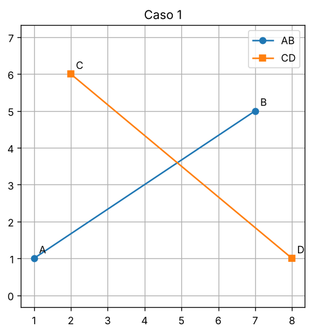
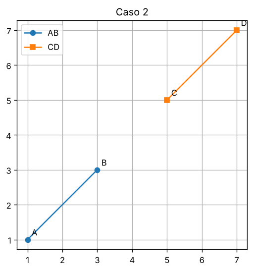
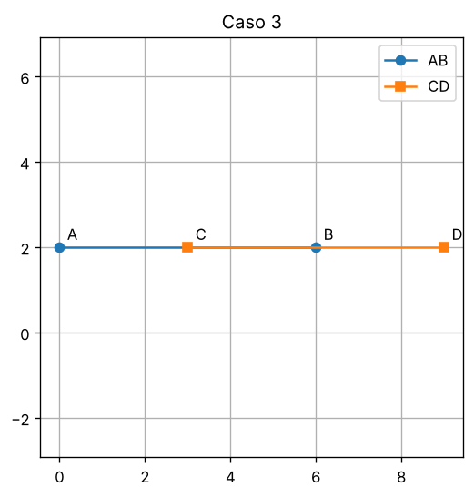
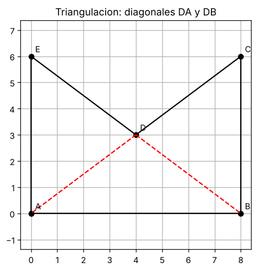

# Análisis de Algoritmos — Geometría computacional

Autor: Jhon Sebastián Trillos Mandon — Ingeniería de Sistemas, UFPSO

Cada ejercicio tiene su script (`ejercicioN.py`). Para correrlos: `pip install matplotlib` y luego `python ejercicioN.py`. Las gráficas se guardan en `img/`.

---

## Ejercicio 1: Giro del robot

Con A = posición anterior, B = actual y C = destino:

`det = (Bx−Ax)(Cy−By) − (By−Ay)(Cx−Bx)`

det > 0 antihorario, det < 0 horario, det = 0 colineal.

| Caso | B−A | C−B | Determinante | Giro |
|---|---|---|---|---|
| 1 | (4,1) | (−2,4) | 4·4 − 1·(−2) = **18** | Antihorario |
| 2 | (4,4) | (2,−3) | 4·(−3) − 4·2 = **−20** | Horario |
| 3 | (2,2) | (3,3) | 2·3 − 2·3 = **0** | Colineal |
| 4 | (5,0) | (−2,−3) | 5·(−3) − 0·(−2) = **−15** | Horario |

Código: `ejercicio1.py`.

**T(n):** cada caso hace un número fijo de operaciones (5 restas, 2 multiplicaciones, 1 resta final y 1–2 comparaciones), así que T = c = **O(1)** por caso. Para n casos, T(n) = c·n = O(n).

---

## Ejercicio 2: Intersección de segmentos

Orientación: `orient(P,Q,R) = (Qx−Px)(Ry−Py) − (Qy−Py)(Rx−Px)`. Para AB y CD: o1 = orient(A,B,C), o2 = orient(A,B,D), o3 = orient(C,D,A), o4 = orient(C,D,B).

Hay intersección si (o1 ≠ o2 y o3 ≠ o4), o si alguna orientación es 0 y el punto está dentro del segmento (contacto o superposición).

**Caso 1:** A(1,1), B(7,5), C(2,6), D(8,1)

| Orientación | Cálculo | Valor |
|---|---|---|
| o1 | 6·5 − 4·1 | 26 (+) |
| o2 | 6·0 − 4·7 | −28 (−) |
| o3 | 6·(−5) − (−5)(−1) | −35 (−) |
| o4 | 6·(−1) − (−5)(5) | 19 (+) |

o1 ≠ o2 y o3 ≠ o4, por lo tanto **sí se cruzan**, en (44/9, 97/27) ≈ (4.89, 3.59).



**Caso 2:** A(1,1), B(3,3), C(5,5), D(7,7). Las cuatro orientaciones son 0 (todos sobre y = x). Por proyecciones, AB cubre x∈[1,3] y CD cubre x∈[5,7]: no se solapan, **no hay intersección**.



**Caso 3:** el enunciado solo trae A(0,2) y B(6,2). Se asumieron C(3,2) y D(9,2) (**reemplazar si tu enunciado trae otros puntos**). Las cuatro orientaciones son 0 (todo sobre y = 2). AB cubre x∈[0,6] y CD cubre x∈[3,9], se solapan en [3,6]: **hay intersección por superposición**.



**Implementación:** función `interseccion(a, b, c, d)` en `ejercicio2.py`.

**¿Por qué es O(1)?** La función hace siempre una cantidad fija de operaciones: 4 orientaciones (2 multiplicaciones y 5 restas cada una), unas pocas comparaciones y como máximo 4 verificaciones de rango. No hay ciclos ni recursión, y el trabajo no depende del tamaño de ninguna entrada, así que T = c = O(1).

---

## Ejercicio 3: Tuberías que se interceptan

Código base asumido (el enunciado no lo trae):

```python
for i in range(n):
    for j in range(i + 1, n):
        if interceptan(tubo[i], tubo[j]): ...
```

**1. ¿Por qué `j` empieza en i+1?**
- Evita comparar una tubería consigo misma (i, i), que siempre "se cruza" y no tiene sentido.
- Evita comparar el mismo par dos veces: interceptan(i,j) = interceptan(j,i); con j > i cada par se revisa una sola vez.

**2. Tabla de iteraciones** (llamadas por cada i = n−1−i)

| i | N=5 | N=8 |
|---|---|---|
| 0 | 4 | 7 |
| 1 | 3 | 6 |
| 2 | 2 | 5 |
| 3 | 1 | 4 |
| 4 | 0 | 3 |
| 5 | | 2 |
| 6 | | 1 |
| 7 | | 0 |
| **Total** | **10** | **28** |

**3. Expresión exacta:** T(n) = (n−1) + (n−2) + … + 1 + 0 = **n(n−1)/2** = C(n,2), el número de pares posibles.

**4. Sumatoria:**

T(n) = Σ_{i=0}^{n−1} (n−1−i). Con k = n−1−i: Σ_{k=0}^{n−1} k = n(n−1)/2 = (n² − n)/2.

Si cada llamada cuesta c = O(1), el tiempo total es c·(n²−n)/2. El término dominante es n²/2, así que la complejidad es **Θ(n²)**.

**5. Comprobaciones**

| n | n(n−1)/2 |
|---|---|
| 100 | 4 950 |
| 1 000 | 499 500 |
| 10 000 | 49 995 000 |

Al multiplicar n por 10, el trabajo se multiplica casi por 100 (comportamiento cuadrático). Código: `ejercicio3.py`.

---

## Ejercicio 4: Triangulación del terreno

Vértices: A(0,0), B(8,0), C(8,6), D(4,3), E(0,6). Área con signo = 36 > 0, el polígono está en sentido antihorario.

**1. Vértices convexos y cóncavos** (det = (curr−prev) × (next−curr); > 0 convexo, < 0 cóncavo)

| Vértice | Determinante | Tipo |
|---|---|---|
| A | 48 | Convexo |
| B | 48 | Convexo |
| C | 24 | Convexo |
| D | −24 | **Cóncavo** |
| E | 24 | Convexo |

**2. Triángulos y diagonales** (n = 5): triángulos = n−2 = **3**; diagonales internas = n−3 = **2**.

**3. Triangulación válida:** diagonales DA y DB desde el vértice cóncavo D. Triángulos ABD (área 12), BCD (12) y DEA (12); suman 36, igual al área del terreno.



**4. Primera oreja:** una oreja es un vértice convexo cuyo triángulo (prev, v, next) no contiene otros vértices. **C** es oreja: el triángulo BCD no contiene a A ni a E, y se recorta con la diagonal BD (E también es oreja, con diagonal DA). A y B no sirven: D queda justo sobre el borde de sus triángulos (sobre EB y sobre AC).

**5. Condiciones antes de retirar un vértice**
- Debe ser convexo (det > 0 con el polígono en antihorario).
- La diagonal prev–next debe quedar dentro del polígono y no cruzar ninguna arista.
- Ningún otro vértice (basta revisar los cóncavos) puede estar dentro del triángulo (prev, v, next) ni sobre su borde.
- El polígono debe ser simple (sin autointersecciones).
- Si se cumplen, se retira v y se repite con n−1 vértices.

**6. Función en Python**

```python
def diagonales_internas(n):
    if n < 3:
        raise ValueError("Un polígono necesita al menos 3 vértices")
    return n - 3
```

`ejercicio4.py` también incluye una implementación completa de ear clipping que reproduce la triangulación BCD, ABD, ADE.

---

## Ejercicio 5: Algoritmo A (n³) vs B (n²)

| n | T_A(n) = n³ | T_B(n) = n² | T_A / T_B |
|---|---|---|---|
| 10 | 1 000 | 100 | 10 |
| 100 | 1 000 000 | 10 000 | 100 |
| 1 000 | 1 000 000 000 | 1 000 000 | 1 000 |

**Big O:** A es O(n³) y B es O(n²). **Razón:** T_A/T_B = n³/n² = n; la ventaja de B crece linealmente con n.

**Conclusión:** conviene el **algoritmo B**. Con 1 000 vértices hace 1 000 veces menos operaciones. A solo sería razonable para polígonos muy pequeños. Código: `ejercicio5.py`.
